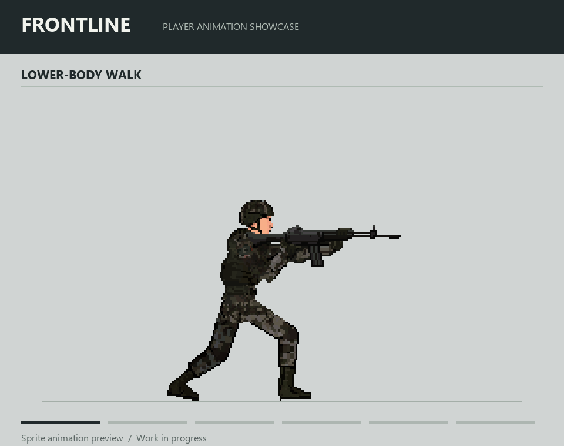

FrontLine을 만들면서 AI의 역할을 코드 구현에서 아트 제작까지 넓혀봤다. 한국군 병사 캐릭터를 만들고, 걷기와 조준부터 재장전·방패·피격·사망 동작까지 제작했다.

목표는 이미지 몇 장을 생성하는 데 그치지 않았다. 같은 캐릭터의 외형을 유지하면서 동작을 추가하고, 수정 가능한 원본과 게임에서 사용할 스프라이트를 함께 관리할 수 있는 제작 환경이 필요했다.

## 제작 도구를 에이전트에 연결했다

처음에는 Codex와 함께 환경과 제작 기준을 구성했고, 이후 Claude Code에서도 같은 도구와 기록을 이어받아 작업했다. ComfyUI와 Pixelorama를 MCP로 연결하고, 내보내기와 검증에는 Python·Pillow를 사용했다.

기본적인 제작 흐름은 다음과 같다.

```text
기준 캐릭터와 동작 레퍼런스
→ 포즈 생성·검토
→ Pixelorama에서 픽셀·레이어·프레임 정리
→ 저장된 원본에서 스프라이트 내보내기
→ 검증과 사용자 승인
→ Unreal Engine 반입
```

ComfyUI에서는 기준 캐릭터와 포즈 정보를 이용해 동작 참고 이미지를 만들었다. 걷기에는 Mixamo 모션도 참고했다. 생성 이미지를 그대로 최종 프레임으로 쓰지는 않고, Pixelorama에서 게임 아트에 맞는 크기와 색상, 레이어 구조로 정리했다.

나는 캐릭터의 비율과 무기 형태, 동작 방향을 정하고 중간 결과를 보며 수정을 요청했다. 에이전트는 도구 조작과 프레임 제작, 파일 정리와 검증을 맡았다.

## 한 장의 그림을 게임용 캐릭터로 바꾸기

캐릭터는 머리, 몸통, 앞뒤 팔, 하체와 무기로 나눴다. 걷는 하체와 조준하는 상체를 조합할 수 있도록 공통 좌표와 연결 기준을 맞췄다.

이 과정에서 생성 결과를 계속 늘리는 것보다 기존 형태를 지키는 일이 더 어려웠다. 걷기에서는 부츠가 중복되거나 다리가 여러 개처럼 보이는 문제가 있었다. 기준 체형을 다시 맞추고, 앞뒤 다리의 명암과 겹친 외곽선을 정리했다.

재장전에서는 손이 탄창을 다루는 동선과 몸통에 가려지는 부분을 수정했다. 조준할 때와 재장전할 때 K2의 모습이 달라지지 않도록 무기 이미지도 맞췄다. 한 동작만 자연스러워 보이는 것으로 끝내지 않고, 다른 동작과 이어서 봤을 때 같은 캐릭터인지 확인했다.

현재까지 만든 주요 동작은 다음과 같다.

- 하체 걷기 루프
- 방향별 K2 조준
- 탄창 교환 재장전
- 방패 꺼내기·방어 유지·피격
- 머리·상체·하체의 정면 피격
- 사망 애니메이션 6종



위 GIF는 승인된 스프라이트를 묶은 아트 프리뷰다. 실제 게임 플레이 녹화는 아니며, 엔진의 조명과 물리·입력 처리는 포함하지 않았다.

## 결과물을 다시 수정할 수 있도록

최종 픽셀 원본은 Pixelorama의 `.pxo` 파일로 관리했다. 레이어와 프레임, 재생 시간을 저장하고, 파일을 다시 연 뒤 공식 CLI로 내보낸 결과를 비교했다.

투명도와 팔레트, 레이어 합성 결과도 검사했다. 내보내기 전후 픽셀 차이가 없다는 것은 저장과 출력이 재현된다는 뜻이지, 동작이 자연스럽다는 뜻은 아니다. 기술 검사를 통과한 뒤에도 실제 재생을 보며 수정할 부분을 골랐다.

승인한 원본과 이전 버전은 보존하고, 새 결과는 별도 버전으로 남겼다. 승인본과 Manifest를 통해 어떤 파일을 엔진에 반입했는지도 추적하도록 했다. Codex에서 Claude Code로 작업을 이어갈 때도 이 기록을 활용했다.

걷기·조준·재장전·방패·피격·사망 자산은 Unreal Engine에 반입했고, 조명 대응을 위한 노멀맵도 제작했다. 다만 에셋 반입과 게임 안에서의 동작 완성은 별개다. 상태 전환과 입력에 연결하고 실제 플레이에서 확인하는 작업은 이어서 진행해야 한다.
