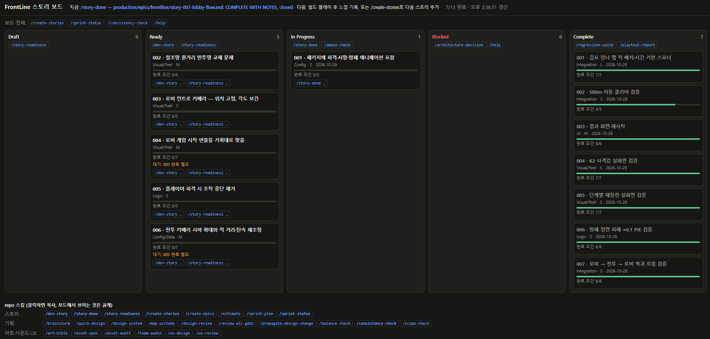
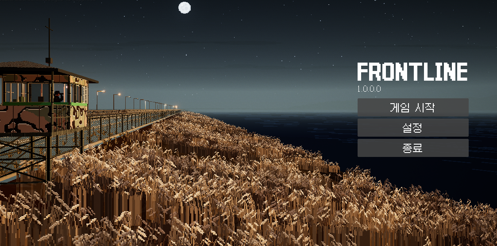

AI와 게임을 개발하다 보면 기능을 구현하는 것만큼, 지금 무엇을 먼저 해야 하는지 정리하는 일이 중요해진다. 기능 추가와 수정 요청이 이어질수록 작업 순서와 완료 기준을 대화만으로 관리하기는 어려워진다.

최근 FrontLine에 [Claude Code Game Studios](https://github.com/Donchitos/Claude-Code-Game-Studios)를 적용했다. 기획·프로그래밍·아트·사운드·QA 등의 역할과 작업 절차를 정의한 템플릿이다. 내게 도움이 된 부분은 에이전트의 수보다, 요청을 작업 단위로 정리하고 검증 결과까지 남기는 흐름이었다.

## 요청을 스토리로 정리하기

이제 기능을 요청할 때 구현 내용뿐 아니라 배경, 완료 조건, 수정 범위와 선행 작업을 스토리 문서에 함께 적는다.

로비를 만들 때도 “시작 화면을 만들어달라”는 하나의 요청으로 묶지 않았다. 배경과 카메라 구도, 메뉴와 설정 화면, 인트로와 게임 시작 연출을 나눠 정리했다. 로비 인트로 카메라를 먼저 확정한 뒤 게임 시작 연출을 검증하도록 선행 관계도 기록했다.

작업 흐름은 다음 명령으로 이어간다.

```text
/create-stories   작업을 스토리로 나누기
/story-readiness  착수 조건 확인
/dev-story        해당 스토리 구현
/story-done       완료 조건과 검증 결과 확인
```

AI에게 무엇을 만들지 설명하는 데서 끝나는 것이 아니라, 어디까지 만들면 이번 작업이 끝나는지도 먼저 정하게 됐다.

## 문서 상태를 보드에서 확인하기

FrontLine에는 스토리 문서를 읽어 상태를 보여주는 읽기 전용 보드도 붙였다. 아래 화면은 프레임워크의 기본 제공 화면이 아니라, 프로젝트 작업을 확인하기 위해 추가한 보드다.



작업은 `Draft`, `Ready`, `In Progress`, `Blocked`, `Complete`로 구분한다. 카드에는 완료 조건의 진행 상황과 선행 작업이 표시되고, 각 상태에서 이어서 사용할 명령도 함께 나온다.

선행 작업이 남아 있는 카드에는 대기 사유가 표시된다. 보드에서 상태를 직접 바꾸는 방식은 아니다. 필요한 명령을 복사해 Claude Code에서 실행하고, 변경된 스토리 문서가 보드에 반영되도록 했다.

## 로비를 만들며 확인한 변화

로비는 달빛이 비치는 한강 하구의 경계 초소를 배경으로 만들었다. 왼쪽에는 초소와 갈대밭을 두고, 오른쪽에는 게임 시작·설정·종료 메뉴를 배치했다.



인트로는 카메라 위치를 고정한 채 하늘에서 초소 구도로 각도만 천천히 내려오도록 만들었다. 이 작업에는 위치가 움직이지 않는지, 하늘 메시의 경계나 검은 영역이 보이지 않는지, 인트로 마지막 구도가 메뉴 화면과 같은지 등의 완료 조건을 적었다.

`/story-done`에서는 설정값과 화면 캡처, 직접 재생하며 확인한 내용을 구분해 기록했다. 메뉴가 표시되는 것과 게임 시작 연출까지 확인하는 것은 다른 작업이므로, 인트로와 시작 연출도 별도 스토리로 관리했다. 화면 하나를 만드는 과정에서도 무엇이 끝났고 다음에 무엇을 확인해야 하는지 정리할 수 있었다.

## 필요한 만큼 적용하기

FrontLine에서는 절차를 가볍게 적용하는 `minimal` 설정을 사용하고 있다. 모든 기능에 긴 설계 문서를 만드는 대신, 지금 필요한 작업과 완료 조건을 중심으로 관리하려는 선택이다.

적용 후 가장 체감하는 변화는 다음 작업을 고르기 쉬워졌다는 점이다. 대화 기록을 거슬러 올라가기보다 보드와 스토리 문서에서 현재 상태, 남은 조건, 선행 작업을 확인할 수 있다.

게임의 방향과 플레이 감각은 여전히 내가 판단한다. Claude Code Game Studios는 그 판단을 대신하기보다, AI와 진행하는 작업을 나누고 이어가는 데 도움이 됐다.
