이번 주에는 FrontLine의 적 아트워크를 보강했다. 소총병과 기관총병, RPG병, 드론까지 각 적의 움직임을 정리하고, 기존 캐릭터와 어울리도록 비율과 표현을 다듬었다.

이전에 만든 아트 파이프라인을 실제 제작에 활용하는 작업이었다. 나는 형태와 동작의 방향을 정하고 중간 결과를 검토했다. AI 에이전트에는 이미지 생성과 프레임 구성, Pixelorama 작업, 내보내기와 검증을 맡겼다.

## 생성보다 수정에 집중했다

기관총병과 RPG병은 ChatGPT 이미지 생성으로 기준 자세를 만든 뒤, 게임에 맞는 픽셀 크기와 팔레트로 정리했다. 한 장이 괜찮아 보여도 움직이면 무기 형태나 신체 비율이 달라 보이는 부분이 있었다. GIF로 반복 재생하면서 어색한 구간을 찾아 수정했다.

기관총병은 엎드린 자세에서 대기·사격·피격·사망이 이어지도록 구성했다. 다른 캐릭터와 크기와 픽셀 밀도가 어울리도록 다시 축소하고 외곽선과 밝기도 조정했다.

RPG병은 재장전에 손이 많이 갔다. 발사관의 비율부터 손과 팔의 움직임, 예비탄의 형태와 위치를 고쳤다. 재장전은 3초로 맞추고, 조준과 발사 동작에 이어서 확인했다.

## 기존 소총병과 새 드론

소총병은 걷기와 조준을 조합하는 구조를 유지하면서 팔 길이와 손 위치, 다리가 겹쳐 보이는 부분을 보강했다. 피격과 다섯 종류의 사망 동작도 함께 정리했다. 동작마다 새 그림을 만드는 것보다 같은 병사의 체형과 무기 잡는 자세를 유지하는 것이 중요했다.

드론은 이미지 생성 대신 스크립트로 형태와 프레임을 제작했다. 비행, 공격 예고, 돌진, 공중 폭발과 낙하를 나누고, 게임 배경 위에 합성해 크기와 방향을 확인했다. 이 과정에서는 탄두 방향과 공격 예고의 반짝임 위치도 수정했다.

## 수정 가능한 결과물로 남기기

병사 애니메이션은 Pixelorama 원본에 레이어와 프레임 시간을 저장하고, 다시 열어 내보낸 이미지가 제작본과 일치하는지 검사했다. 승인본은 이전 버전과 분리해 보관하고, Manifest에 원본과 엔진 반입 기록을 남겼다.

AI에 한 번 요청해서 완성한 작업은 아니다. 움직이는 결과를 보고 구체적으로 수정을 요청하는 과정을 반복했다. 에이전트가 제작과 파일 정리를 맡아준 덕분에, 나는 형태와 동작을 판단하는 데 집중할 수 있었다.

아래는 제작 결과를 확인하기 위한 애니메이션 프리뷰다. 승인된 자산의 Unreal Engine 반입 기록은 확인했지만, GIF 자체가 실제 게임 플레이 검증을 뜻하지는 않는다.

## 소총병

걷기 비교. 오른쪽이 적 캐릭터다.

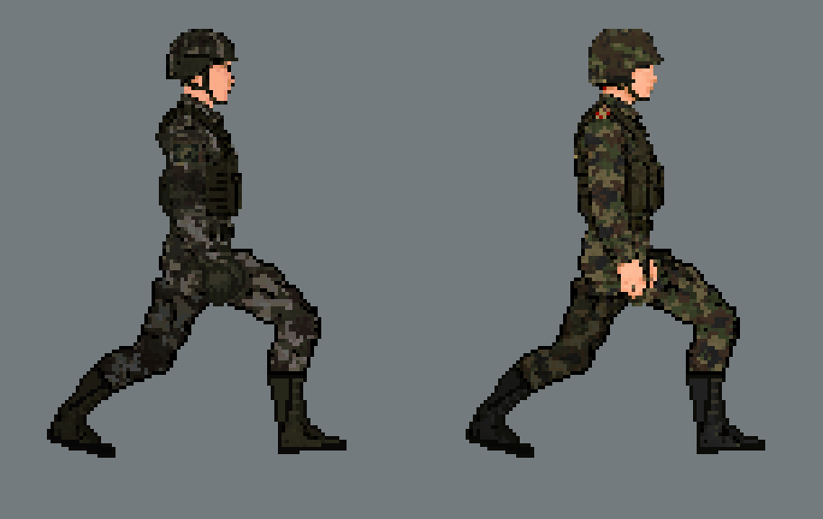

조준 시 팔 길이 비교. 아래쪽이 적이며, B안으로 납품했다.

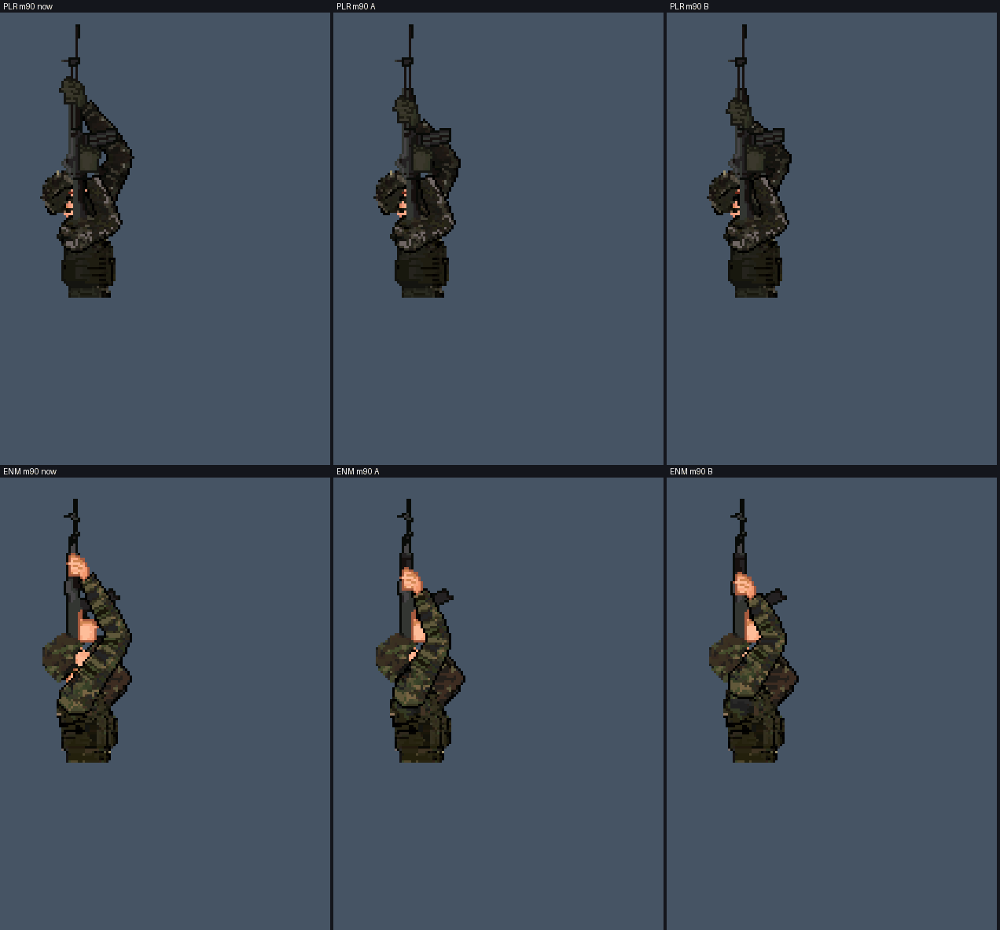

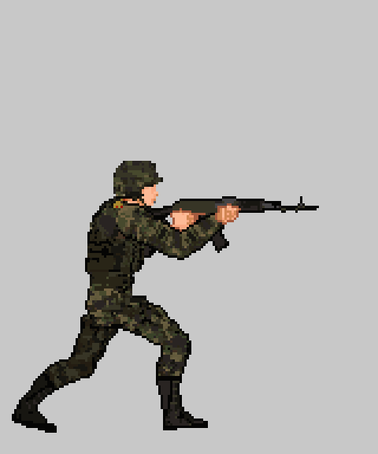

사망 5종: 상체·머리·하체·파편·폭발.

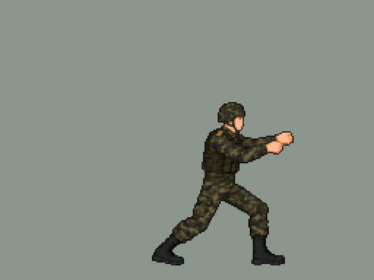
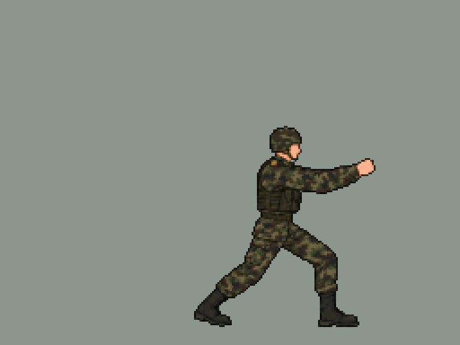
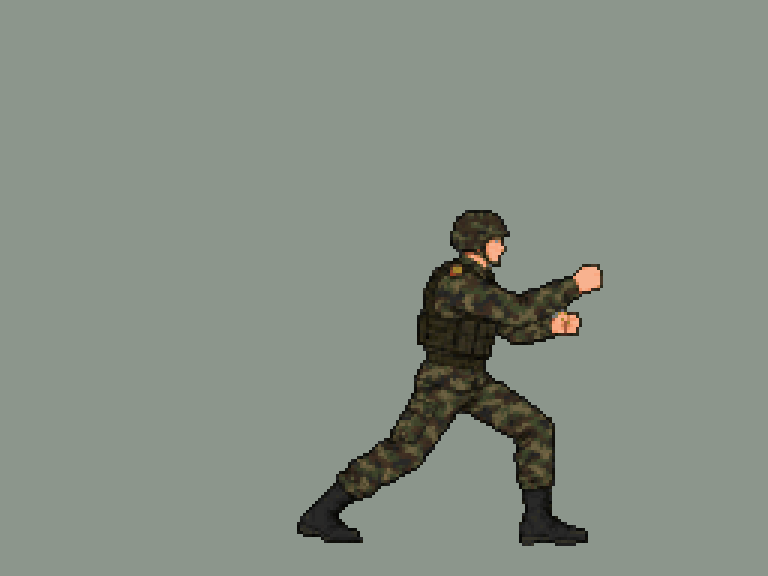
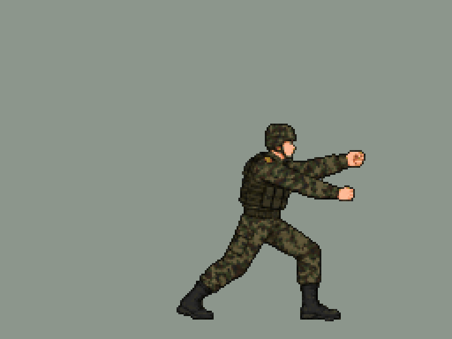
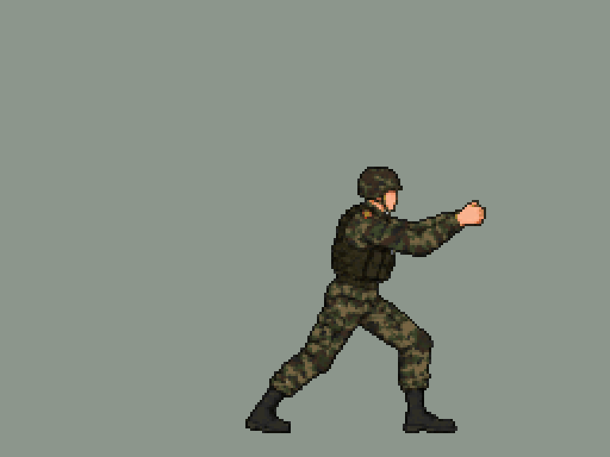

## 기관총병

대기·사격·피격·사망 순서다.

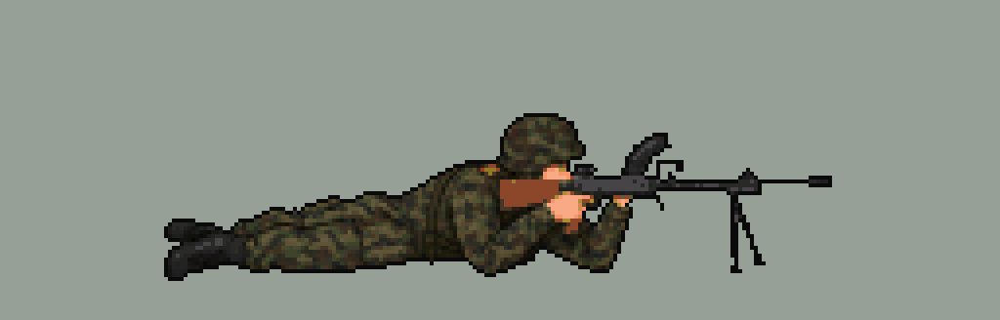
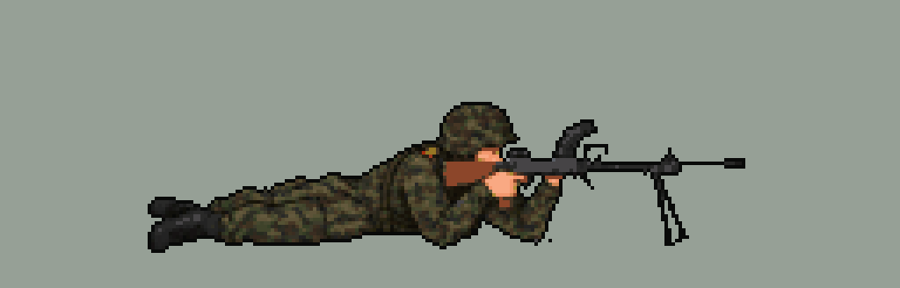
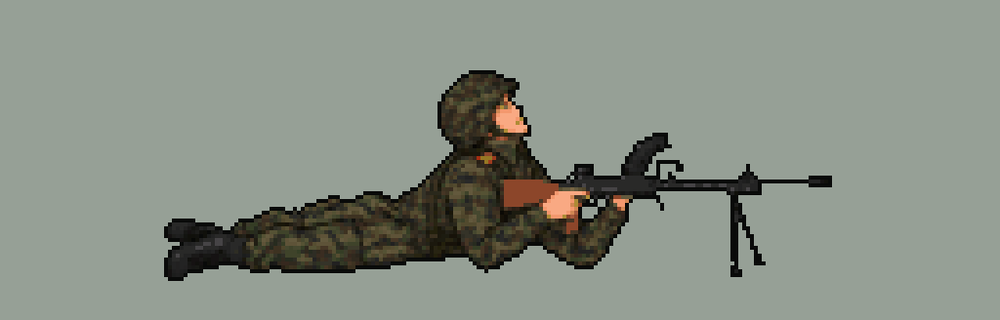

## RPG병

조준·발사·재장전·피격 순서다. 사망은 소총병 자산을 재사용하는 구성이다.

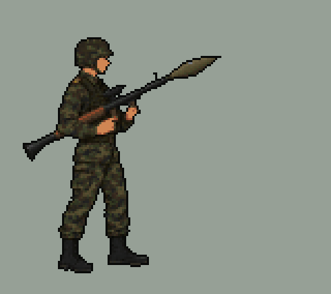
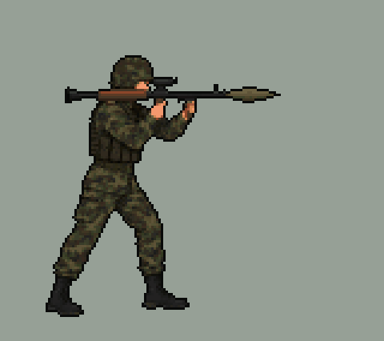
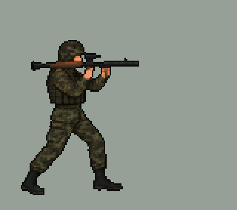
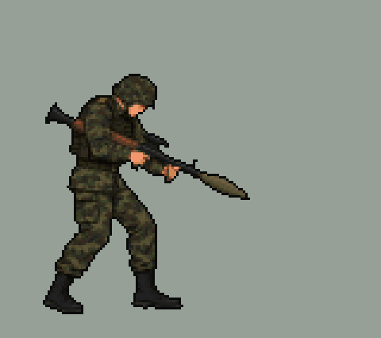

## 드론

동작 모음과 배경 합성이다. 동작 모음의 피격은 제작됐지만, 체력 1인 게임 구성에서는 사용하지 않는다.

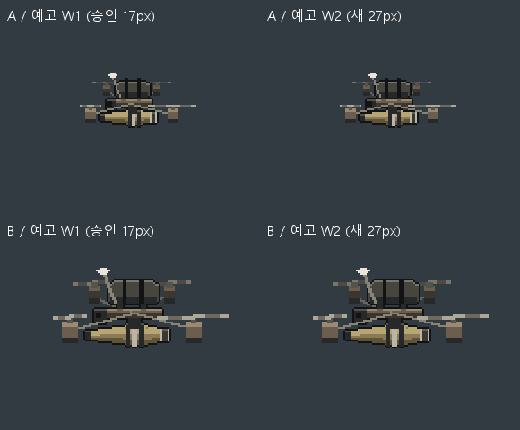
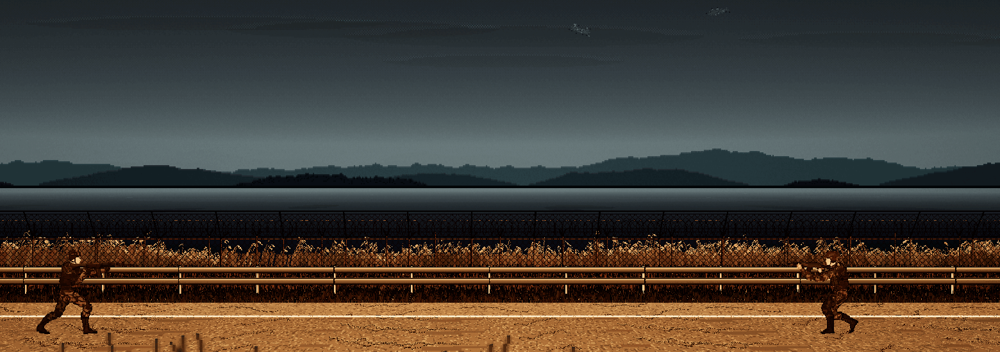
