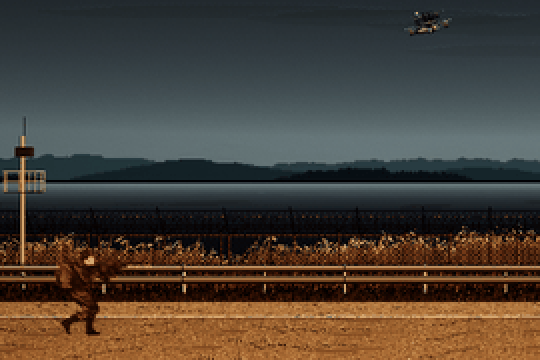
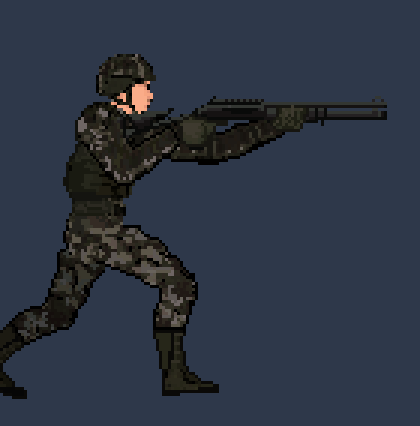
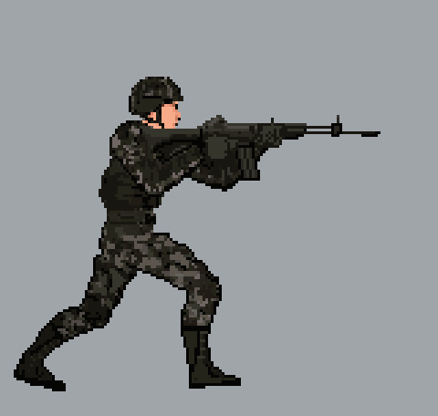

이번 주에는 FrontLine의 플레이어 장비를 보강했다. 드론을 교란하는 재머와 배넬리 M4 샷건을 추가하고, 장비 사용에 필요한 아트와 전투 동작을 연결했다.

AI 에이전트와 작업하면서 기능 구현과 아트 제작을 스토리 단위로 나눴다. 나는 동작 방식과 제작 방향을 정하고, 중간 결과와 실제 플레이를 보며 수정을 요청했다.

## 드론 재머

재머는 범위 안의 드론을 확률적으로 교란해 추락시키는 장비다. 기존 드론의 낙하 상태와 처치 처리를 재사용해, 재밍으로 떨어뜨린 드론도 처치 수와 경험치에 반영하도록 했다.

플레이어가 장비를 사용하고 있다는 것이 보이도록 등 뒤에 재머 가방을 붙이고, 영향을 받은 드론에는 떨림을 추가했다. 재머의 충전량과 사용 상태는 체력 막대 위 게이지로 표시한다.

가방은 기본 자세에만 붙이지 않았다. 재장전·방패·무기 교체·피격·사망과 무전기 사용 자세에 맞는 아트를 제작하고, 캐릭터의 애니메이션 프레임을 따라가도록 연결했다.

## 배넬리 M4 샷건과 무기 교체

기존 K2에 더해 배넬리 M4 샷건을 추가했다. 단순히 총 이미지와 공격력만 바꾸는 대신, 산탄 발사와 튜브 탄창에 맞는 재장전 동작을 구현했다.

탄이 남아 있을 때는 한 발씩 보충하고, 모두 소모했을 때는 배출구로 탄을 넣고 볼트를 닫은 뒤 튜브 장전으로 이어진다.

K2와 M4의 탄약 상태는 각각 유지하며, M4의 유한한 예비 탄약은 화면 하단에서 상점으로 구매하도록 했다.

무기 교체에도 집어넣기와 꺼내기 동작을 추가했다. 걷는 하체는 유지하면서 상체가 무기를 바꾸고, 집어넣기가 끝나는 시점에 장착 무기와 HUD가 전환된다.

교체 중에는 사격과 재장전을 막고, 재장전 도중 무기를 바꾸더라도 진행된 탄약 상태는 보존하도록 했다. 아트만 추가하는 것이 아니라 기존 전투 동작과 충돌하지 않게 연결하는 작업이었다.
