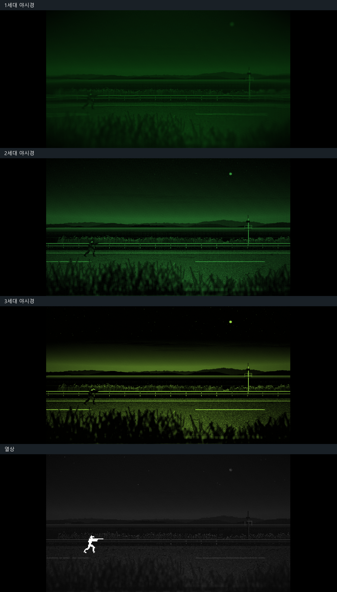
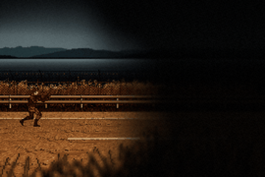

FrontLine에서 밤에 총구가 번쩍이면 야시경 화면은 잠깐 눈부셔지지만, 열상 화면에는 작은 흰 열점만 남는다. 두 장비에 같은 후처리 머티리얼을 쓰되, 야시경은 주변 빛에 반응하고 열상은 열을 내는 대상만 밝게 그리도록 나눴다.

## 열상: 색 대신 열원 표시하기

열상에서는 배경을 어두운 회색조로 유지했다. 캐릭터의 몸은 화면 색으로 찾지 않고, 스프라이트에 언리얼의 커스텀 스텐실 값을 기록해 구분했다. 살아 있는 캐릭터는 흰색으로 보이고, 쓰러지면 5초에 걸쳐 스텐실 값을 낮춰 배경과 비슷한 밝기로 식게 했다. 몸이 벽이나 차량에 가려진 부분은 흰 실루엣으로 드러나지 않는다.

격발과 폭발은 몸과 다른 방식으로 그렸다. 빛이 발생한 위치에 작은 열점을 표시하되, 그 빛으로 화면 전체의 밝기를 올리지는 않았다.

## 야시경: 세대마다 다른 빛 번짐

야시경을 켜면 맨눈으로 볼 때의 어둠 마스크를 끄고 화면 전체에 세대별 밝기와 색조를 적용한다. 1세대는 짙은 초록색에 가장자리가 흐리고, 2세대는 가장자리까지 선명해진다. 3세대는 노란빛이 도는 연두색에 더 높은 대비와 고운 입자를 썼다. 오른쪽에서 다가오는 적을 가리지 않도록 둥근 고글 테두리는 그리지 않고 모서리만 어둡게 했다.

*위에서부터 야시경 1세대, 2세대, 3세대, 열상. 같은 위치에서 촬영했다.*

밝기·대비·입자·번짐 세기는 `UFrontLineVisionData`에 세대별로 두었다. 같은 섬광이라도 1세대에서는 화면이 크게 하얘지고, 3세대에서는 덜 번진다. 장비를 갖춘 뒤에는 어두워질 때 자동으로 켜지는 대신 플레이어가 `N` 키로 켜고 끈다.

*1세대 야시경 전환 장면. 화면 변화를 볼 수 있도록 적과 사격이 없는 구간에서 촬영했다.*
