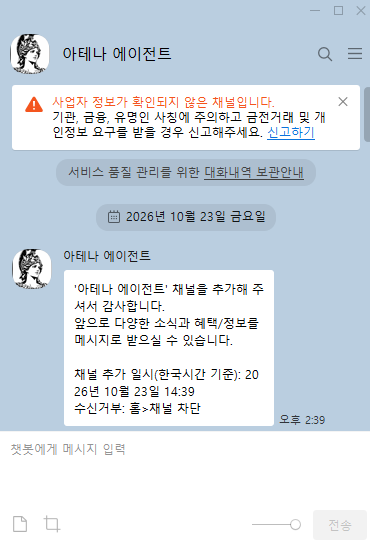

[AI_TOP_100 [2026] 대회](https://aitop100.org/)에 참가하면서 카카오톡 채널 챗봇 개발 권한을 받았다. 이를 계기로 ‘아테나 에이전트’라는 채널을 만들었다.

대회는 10월 31일 온라인 예선을 앞두고 있다. 제출할 에이전트를 준비하면서, 대회 과제를 푸는 것 외에 이 채널로 무엇을 해볼 수 있을지도 생각하고 있다.

## AI에게 요청하는 또 다른 창구

지금까지는 Codex와 Claude에서 개발 작업을 진행하고, Hermes 봇에는 Discord를 통해 반복 업무를 맡겼다. 카카오톡 채널은 여기에 새로운 요청 창구를 더할 기회다.

관심이 가는 부분은 익숙한 메신저에서 필요한 일을 바로 요청할 수 있다는 점이다. 별도의 프로그램을 열지 않고 메시지를 보내는 방식으로 내 자료를 찾거나, 기록을 남기고, 결과를 확인할 수 있다면 활용할 곳이 있을 것 같다.

다만 질문에 답하는 챗봇을 하나 더 만드는 것만으로는 용도가 분명하지 않다. 내가 가진 자료나 기존 업무 중 무엇을 연결할지가 더 중요한 문제다.

## 현재 준비한 구조

현재 프로젝트에서는 카카오 메시지를 받는 연결 부분과 답변을 생성하는 부분을 분리했다. Claude로 답변을 만들고, 복잡한 질문에는 다른 모델의 추가 검토를 요청하는 구조를 코드로 준비했다.

카카오톡에서 읽기 편하도록 답변 길이와 마크다운 기호를 정리하고, API 호출이 실패했을 때 보낼 안내 문장도 마련했다.

아직은 기본적인 텍스트 응답을 위한 준비 단계다. 대화 기억, 자료 검색, 기존 Hermes 업무와의 연동까지 구현한 것은 아니다.

## 무엇을 연결해볼까

지금 생각하는 활용 방향은 세 가지다. 모두 추가 구현과 연동이 필요한 아이디어다.

첫 번째는 **기존 개인 자동화의 요청 창구**다. Hermes에서 관리하던 개발 정보나 운동 기록을 카카오톡에서도 조회하고 입력할 수 있도록 연결해보고 싶다. 이미 있는 처리 기능을 활용하면서 접근하는 방법을 늘리는 방향이다.

두 번째는 **게임 프로젝트 안내 봇**이다. 제작 기록과 기능 설명을 자료로 연결해, 내 게임에 관한 질문에 답하도록 만드는 것이다. 플레이 방법이나 테스트 중 자주 나오는 질문을 정리하는 데 사용할 수 있을지 생각하고 있다.

세 번째는 **메모와 작업 요청을 정리하는 보조 도구**다. 대화 중 떠오른 내용을 메모로 남기고 할 일로 정리하되, 외부 게시나 실제 변경이 필요한 작업은 확인을 거쳐 실행하는 방식이다.

먼저 대회 과제에 맞는 에이전트를 준비하고, 추가 활용은 권한의 사용 조건을 확인하면서 구체화하려 한다. 이번에는 무엇이든 처리하는 봇을 목표로 잡기보다, 카카오톡으로 요청했을 때 실제로 편해지는 일 하나를 찾아보고 싶다.

참가 대회: [AI_TOP_100 [2026] 공식 사이트](https://aitop100.org/)
